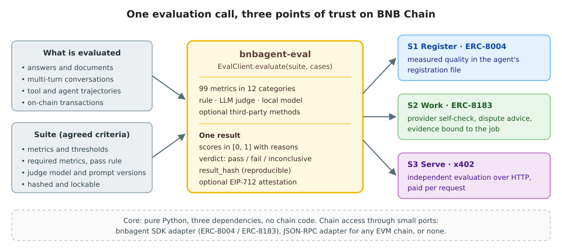

# bnbagent-eval overview: what, why and how

Agents on BNB Chain can register an identity (ERC-8004), take paid jobs (ERC-8183) and pay
each other per request (x402). What they cannot yet do is show, check or dispute **how well**
an agent works. `bnbagent-eval` adds that missing layer. One call turns an agent's outputs,
conversations, tool use and transactions into a reproducible, verifiable quality result, and
that result can be used at registration, during a job and as a paid service.

This document explains the problem, what the package offers, what results you get, and how the
capability was transferred from AWS to BNB Chain.



## 1. Background

An agent economy needs three kinds of trust, and the bnbagent SDK provides the rails for each:

| Stage | Standard | What the SDK provides |
|---|---|---|
| Discovery | ERC-8004 | an on-chain identity and a registration file: name, description, endpoints |
| Work | ERC-8183 | jobs with escrowed budgets: fund, submit a deliverable, settle, dispute, vote |
| Payment | x402 | per-request HTTP payments (a client-side signer and payer) |

All three move value between parties who do not know each other. Each of them therefore has a
point where someone has to judge the quality of an agent's work.

## 2. The gap

| Decision | Today | Consequence |
|---|---|---|
| *Which agent should I hire?* | The registration file describes what an agent says it does, not how well it does it | buyers choose on self-description; good agents cannot prove that they are good |
| *Is this deliverable acceptable?* | The ERC-8183 optimistic policy approves a submission when no one disputes it within the window; the client decides alone whether to dispute | poor work is paid by default; disputes rest on opinion |
| *How should a voter vote?* | Voters can `vote_reject` but receive no structured evidence | outcomes vary by voter and are hard to audit |
| *Can I buy an independent check?* | x402 exists only on the client side; no evaluation service exists | agents without their own evaluation stack have nowhere to go |

Existing evaluation tools do not close this gap on their own:

- **Platform toolkits**, such as the AWS Gen AI Evaluation Toolkit (ETK) and AgentSight, have broad
  and proven metrics. They are built as hosted cloud platforms (API Gateway, Lambda, ECS,
  Step Functions), however, and know nothing about chains, jobs or payments.
- **Open-source libraries** (RAGAS, DeepEval and others) each cover a slice. They use different
  scales and conventions, and produce no verdict and no reproducible fingerprint that a third
  party could check.

On-chain use adds requirements that general-purpose evaluation does not have:

1. **Verifiable.** A counterparty must be able to recompute a result and confirm that it belongs to
   this job, this output and these criteria.
2. **Agreed in advance.** The criteria (suite) are fixed and hashed before the work is judged.
3. **Robust to adversaries.** The evaluated output may try to manipulate the judge, and a suite
   or URL may be hostile.
4. **Light and portable.** It runs inside an agent, a voter's script or a small service, with no
   cloud platform behind it.

## 3. What bnbagent-eval offers

1. **Breadth in one consistent model.** 99 canonical metrics in 12 categories: text, format,
   ops, quality, safety, RAG, conversation, agent, on-chain, red-team, code and custom. Every
   metric scores in [0, 1], higher is better, with a reason and full provenance.
   - Methods per metric: deterministic rules, LLM judges (Bedrock, Anthropic or any
     OpenAI-compatible API) and local models.
   - Third-party evaluators (RAGAS, DeepEval, FMEval, AgentCore) are available as optional,
     clearly labelled alternatives.
2. **One call, three uses.**
   - `EvalClient.evaluate` returns the same result model whether it runs in development, at
     registration (S1), during a job (S2) or behind a paid endpoint (S3).
   - The same metric code scores a deliverable in the provider's self-check and in a dispute.
3. **Verifiable results.**
   - Suites are hashed and can be locked to metric and prompt versions.
   - Each result carries a `result_hash`, identical on Python 3.10 to 3.12, and can be signed
     (EIP-712).
   - Job evidence is bound to the job, the deliverable and the suite.
4. **Security by design.**
   - Untrusted text is fenced in judge prompts.
   - Every outbound fetch passes a public-address guard with DNS pinning and size caps.
   - Suites submitted to the service run under an untrusted-suite policy.
   - Payments are bound to quotes and protected against replay.
5. **Independent, light core.**
   - The core is pure Python, with three dependencies and no chain code.
   - BNB Chain is reached only through small ports: an adapter for the bnbagent SDK, and a
     JSON-RPC adapter for any EVM chain. The package also works with no chain at all
     ([STANDALONE.md](STANDALONE.md)).
6. **Beyond scoring.**
   - Judge calibration against human labels.
   - Test-case and red-team generation, simulated users and error injection.
   - Failure diagnosis with recommendations, and reports in JSON, Markdown, console and CSV.

## 4. Using it: what you get

| Goal | Do this | You get |
|---|---|---|
| Know where your agent stands | `bnbagent-eval run --suite suite.yaml --cases cases.jsonl` | per-metric and per-case scores, a verdict, `result_hash` |
| Find out why it fails | add `--diagnose diagnosis.json` | root causes per failing metric, with recommendations |
| Test a live agent | `--target a2a:<agent card URL>` or `--target mcp:<tool>@<URL>` | the same result, from real calls to the agent |
| Prove quality to buyers (S1) | run at stage `registration`, then `bnbagent-eval publish` | the metrics in the agent's ERC-8004 registration file, with a hash |
| Submit only good work (S2) | wrap the job handler with `EvalGate` or run `bnbagent-eval watch` | deliverables checked before `submit`, with the evidence attached |
| Decide on a dispute or a vote (S2) | `bnbagent-eval review <job id>` (`--as voter`) | advice (dispute, vote or abstain) with reasons and the deadline |
| Sell or buy evaluations (S3) | `bnbagent-eval serve --pay-to …`; `EvalClient.remote(url)` | a signed result over HTTP, paid per request with x402 |
| Trust your judge | `bnbagent-eval calibrate --suite … --cases … --min-kappa 0.6` | agreement with human labels (Cohen's κ) and a pass / fail gate |

A worked example: three answers scored for the expected fact, word overlap and latency
([examples/quickstart](../examples/quickstart/README.md); run from `eval/`):

```bash
bnbagent-eval run --suite examples/quickstart/suite.yaml \
  --cases examples/quickstart/cases.jsonl --format console
```

```text
# excerpt of the console report
verdict: FAIL
score: 0.652  pass rate: 0.667  error rate: 0.000  cases: 3  stage: dev
  - required metric failed: text.contains

case     score  passed
fees     0.733  yes
blocks   0.889  yes
approve  0.333  no

result_hash: 0xcd9b44aadff71939525d11333b6ffc6f3bf48aa8c5e70f79a117b5f818f82755
```

The `approve` answer is wrong ("it sends your tokens" instead of granting an allowance). The
required `text.contains` check catches it, so the run fails even though the average score
(0.652) clears the 0.6 pass rule. Anyone who reruns the same suite on the same cases obtains
the same `result_hash`.

## 5. Evidence of quality

| Property | Result | Source |
|---|---|---|
| Coverage of ETK, AgentSight, STED and the earlier prototype | 258 source items classified; 0 missing; every ported metric mapped to a canonical ID and method | [source-map.md](design/source-map.md) |
| Fidelity of ported algorithms | ROUGE, Porter stemmer, Treebank tokenizer, BERTScore and STED parity-tested against their reference implementations; text metrics against recorded reference values | [testing.md](design/testing.md) |
| Judges on a real model | all 70 judge methods separate a good from a bad case on Claude Haiku 5.5 (Bedrock), and 23 of 23 sampled on Claude Sonnet 5.5 | [live sweep](../benchmarks/live-sweep/2026-11-02.md) |
| Agreement with human labels | Sonnet 5.5: κ = 1.00 on faithfulness and helpfulness, 0.70 on relevance | [calibration report](../benchmarks/calibration/REPORT.md) |
| Reproducibility | identical `result_hash` on Python 3.10, 3.11 and 3.12 | determinism check in CI |
| On-chain (S1, BSC testnet) | a Q&A agent was evaluated (verdict pass over 10 cases) and its scores published to its ERC-8004 registration (agent 2714); read back from the registry, `result_hash` matching the local run | [publish transaction](https://testnet.bscscan.com/tx/0xfa45cba52b12b23bb2d095c82c08c3ffdbc3df8e4d7fa8b775cbfe792d39c182) |
| Engineering | about 4,950 offline tests; a contract suite over every (metric, method) pair; enforced layer boundaries; no network in tests | [testing.md](design/testing.md) |

## 6. From AWS to BNB Chain

ETK and AgentSight are AWS evaluation toolkits for generative-AI applications and agents. This
package transfers their evaluation **capability** from AWS to BNB Chain, without the hosting
platform:

| Transferred | Left behind | Added for BNB Chain |
|---|---|---|
| ETK metrics (quality, safety, RAG, text, format, red-team) and AgentSight agent and conversation evaluators, re-implemented in one model | API Gateway, Lambda, ECS, Step Functions, CDK / Terraform, Cognito, S3 job stores, dashboards | ERC-8004 publication, ERC-8183 gate / advisors / evidence, an x402 eval service, on-chain metrics |
| Judge prompts, versioned and hash-pinned | hard dependency on AWS | provider-neutral judges with defaults that you can override |
| Calibration, generation, diagnosis | | reproducible hashes, EIP-712 attestations, the untrusted-input security model |

BNB Chain receives a self-contained, Apache-2.0 package in `bnbagent-sdk/eval/`: its own CI, a
user guide, a maintainer guide with the metric source map, and a test suite that runs offline.
New metrics are added through one registry and are covered by the contract tests automatically
([MAINTAINER_GUIDE.md](MAINTAINER_GUIDE.md#adding-a-metric)).

## 7. Limits

- **Evidence informs; it does not enforce.** The current ERC-8183 optimistic policy ignores
  evidence bytes on chain. The evaluation guides providers, clients and voters. Automatic
  enforcement would need a new policy contract, which is out of scope.
- **Judges need calibration.** The bundled calibration set is small (16 cases, one annotator).
  Calibrate on labelled data from your own domain before relying on a judge in disputes.
- **Testnet validation in progress.** S1 has run on BSC testnet. S2 and S3 are tested against
  in-memory ports, the real SDK code paths and the live token contracts (read-only), and wait
  for funded testnet wallets ([TESTNET.md](TESTNET.md)).

Start with the [user guide](USER_GUIDE.md).
