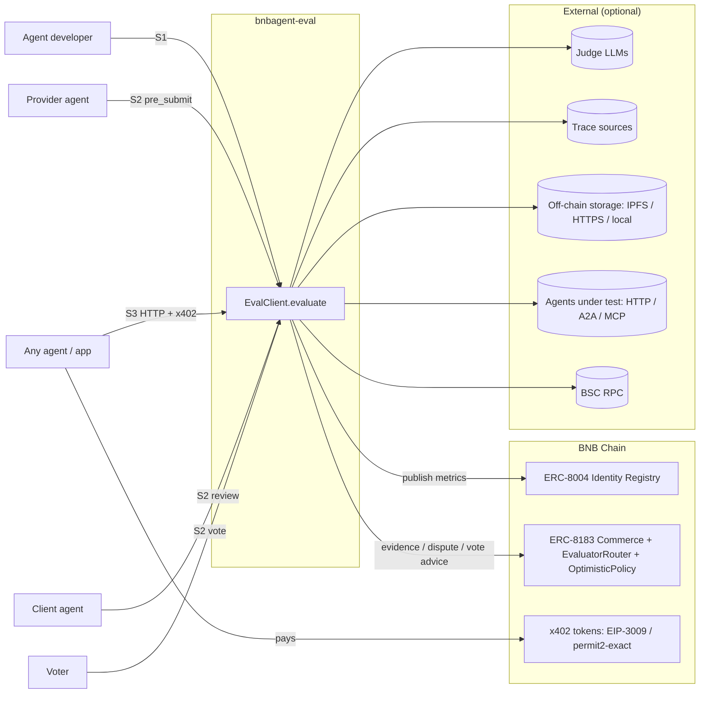
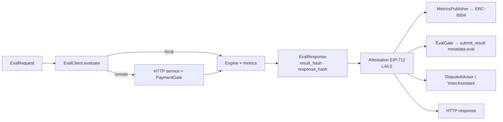
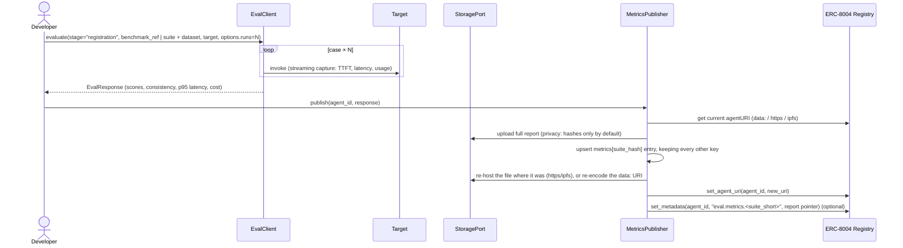

# System architecture

Scope, layers, the unified call, the S1 / S2 / S3 flows, data contracts and the key design
decisions of `bnbagent-eval`. Diagram: [`architecture.svg`](architecture.svg). Code-level design
is in [implementation.md](implementation.md), the metrics in [metric-catalog.md](metric-catalog.md),
the security model in [security.md](security.md).

## 1. Purpose and scope

`bnbagent-eval` is a Python library that lets developers, agents, voters and services on BNB Chain
**measure the quality of an AI agent and use the measurement on-chain**.

It unifies every evaluation capability of AWS Gen AI ETK and AgentSight into one catalogue, behind
one evaluation call, and that call serves three on-chain scenarios:

| # | Scenario | Who calls | Result goes to |
|---|---|---|---|
| S1 | **Pre-registration benchmark** | Agent developer | ERC-8004 registration file (`metrics` list, one entry per suite) and an off-chain full report |
| S2 | **Per-job evaluation** | Provider (self-check before submit), client (review → dispute or not), voter (vote → vote_reject or abstain) | ERC-8183 `DeliverableManifest.metadata.eval` (evidence bound to the job and the output), plus advice to dispute or vote |
| S3 | **Evaluation as a service** | Any agent, over HTTP | HTTP response (attested), optionally paid via x402 |

**In scope:**
- Every metric: deterministic, LLM-judge, model-based and vendor.
- Judge abstraction and judge calibration.
- Trace ingestion.
- Run orchestration: targets, simulated users, budgets, deadlines.
- Aggregation and verdicts.
- Analysis: confidence, insights, diagnosis, recommendation.
- Authoring.
- Generation: test cases, red-team, error injection.
- Chain helpers.
- The HTTP service with an x402 gate.

**Out of scope:**
- ETK/AgentSight infrastructure (API Gateway, Lambda, ECS, Step Functions, CDK, Terraform, Cognito, S3 job stores).
- Dashboards and UI.
- Solidity contracts (see §12).
- Changes to existing `bnbagent` code.

## 2. Architectural principles

1. **One call, one result model.** Every scenario uses `EvalClient.evaluate(EvalRequest) -> EvalResponse`.
   Scenarios differ only in `stage` and in what is done with the response afterwards. The same metric code
   runs in development and in a dispute.
2. **Independent, light, portable; BNB is reached only through ports and adapters.**
   - The core depends only on `httpx`, `pyyaml` and `eth-hash[pycryptodome]`. It contains **no BNB code**.
   - Chain workflows (`chain/`) are pure logic written against our own small **ports**. These are Protocols plus neutral value types,
     defined in L1 (`bnbagent_eval/ports.py`), e.g. `RegistryPort`, `CommercePort`, `SignerPort`.
   - The **only** module that imports the bnbagent SDK is the adapter `integrations/bnbagent/`, shipped as the
     `[bnbagent]` extra. A JSON-RPC adapter (`integrations/jsonrpc`) covers read-only chain access with no web3: receipts, balances and logs over httpx in the core; `eth_call` encoding and calldata decoding need `[evm]`.
   - EVM signing and verification (EIP-712, EIP-3009, ABI) use the `[evm]` extra (`eth-account`, `eth-abi`). It does not need web3.
   - The service exposes a language-neutral API link: OpenAPI 3.1 plus JSON Schemas for every contract. TypeScript or other
     clients can call the service and verify evidence without Python.
   - AWS, ML frameworks and vendor libraries are extras too. Extras are imported lazily, and the error names the extra to install.
3. **Provider-agnostic judges** through the `JudgeModel` protocol. Bedrock is one provider among several.
4. **Canonical metrics, many methods.** Overlapping implementations become `method`s of one canonical ID, and
   vendor names remain as aliases. Polarity and required inputs are declared **per method**.
5. **One scoring convention.** `score ∈ [0, 1]` and higher is better. Inversion is applied per method, and the raw value is kept.
6. **Verifiable and reproducible.**
   - A deterministic `result_hash` covers scores, details and versions. A `response_hash` envelope adds the volatile fields.
   - The subject is bound into the hash: chain, job, provider, output hash.
   - The attestation is EIP-712, with a domain and an expiry.
   - Fencing is deterministic, so replays match. The judge source (live or cache) is recorded.
7. **Untrusted by default.** Deliverables, suites and requests from other parties are untrusted.
   - The service runs only allow-listed metrics.
   - Evidence is checked against the *negotiated* suite, not one the provider picked.
   - Missing or failed required metrics never count as passes.
8. **Privacy-aware.** Reports contain hashes, not raw content, by default. Encrypted reports and server-side no-retention are options.
9. **Follow SDK conventions:** Python ≥3.10, dataclasses + Protocols, async-first, `EVAL_` env prefix, `logging.getLogger(__name__)`, no pydantic.
10. **Isolation and separability.** A new top-level `eval/` directory in `bnbagent-sdk` with its own `pyproject.toml` and its own CI workflow.
    No existing file changes. The directory has no path or code dependency on the rest of the repo; the only link is the optional
    `bnbagent` package dependency. So it can be moved to its own repository unchanged.

## 3. Context view



## 4. Layered architecture

See [`architecture.svg`](architecture.svg) for the full diagram.

| Layer | Package | Responsibility |
|---|---|---|
| **L5 Delivery** | `client`, `cli`, `server` | `EvalClient` (local / remote backend), CLI, HTTP service + `PaymentGate`. **Attestation signing happens here.** |
| **L4 Chain workflows** | `chain` | `MetricsPublisher` (ERC-8004), `EvalGate` + `EvidenceBuilder` (provider), `DisputeAdvisor` (client), `VoterAssistant` (voter), attestation, `onchain` enrichment. **Depends only on ports**, never on the SDK. |
| **Edge: integrations** | `integrations.bnbagent` (`[bnbagent]`), `integrations.jsonrpc` (core; `[evm]` for `eth_call`/decoding) | Adapters that implement the ports: the bnbagent SDK adapter (full read/write) and the JSON-RPC adapter (read-only: receipts, balances, `eth_call`, event logs). Third parties can supply their own adapters. |
| **L3 Orchestration** | `authoring`, `generation`, `engine` | Eval maker, rubric lint and recommendation; test-case generation, simulated users, red-team, error injection; suite/benchmark resolution, `Runner` (concurrency, budgets, deadlines, retries), targets, aggregation and verdict, run comparison |
| **L2 Capabilities** | `metrics`, `reporting`, `privacy`, `analysis` | Metric catalogue (including the vendor bridges); reports, exporters and redaction; confidence, insights, diagnosis, judge calibration |
| **L1 Foundations** | `judges`, `adapters`, `ports`, `config`, `types`, `net`, `hashing`, `exceptions` and small helpers | Judge layer, trace adapters, **port Protocols + neutral value types** (`JobView`, `DeliverableView`, …), configuration, the serializable data model (including `TargetRef`), the egress guard, canonical JSON + keccak (including a core re-implementation of the SDK's manifest hash), errors |

**Dependency rules (enforced by tests):**
- A layer imports only layers below it; within a layer, the order is the one in `pyproject.toml` (and [MAINTAINER_GUIDE.md](../MAINTAINER_GUIDE.md#31-layers)).
- **Only `integrations/bnbagent/` may import `bnbagent` or `web3`.** Every other module, including `chain/` and `server/`, depends on ports.
- The adapter is chosen at the composition root: `EvalClient`, CLI or `create_app` configuration, e.g. `integrations.bnbagent.ports(network="bsc-testnet", wallet=…)`.
- `types` holds only serializable descriptions. For example, `TargetRef` is a description, and L3 turns it into a live `Target`.

## 5. Core concepts

| Concept | Description |
|---|---|
| **EvalCase** | One item to evaluate: `input`, `output` (+ `output_content_type`), `artifacts[]` ({uri, hash, media_type, size}), `expected`, `contexts`, `conversation`, `trajectory`, `app_metrics`, `language`, `metadata`. All fields are optional except `id`. |
| **Trajectory** | `Session → Trace → Step`. Step types: LLM, Tool, Agent, Delegation, Handoff, **Tx** (an on-chain transaction: intent, call, receipt, block). |
| **Metric** | Canonical ID + `MetricSpec` (category, methods with their own required inputs and polarity, params schema, default threshold, version) + `evaluate(case, ctx)`. |
| **Suite** | A versioned set of `MetricConfig`s plus judge pin, pass rule and aggregation mode. `suite_hash` covers the fully resolved suite, including `$ref` contents and the lock of metric and prompt versions. |
| **Benchmark** | `{id, version, dataset_uri, dataset_hash, splits, suite_hash}`. A public or held-out dataset tied to a suite, for S1 comparability. |
| **TargetRef** | A serializable description of the agent under test: `callable` (local only), `http`, `a2a`, `mcp`, `erc8004` (resolve the endpoint from an agent ID), optionally behind a `simulated_user`. |
| **EvalRequest** | `{schema_version, stage, suite / suite_ref, cases / dataset_ref / benchmark_ref, target?, subject?, options}`. `options` contains `runs`, `deadline`, `budget`, `privacy`, `language`, `judge_override`. |
| **EvalResponse** | `{schema_version, stage, subject, suite_hash, results, aggregate, verdict, provenance, cost, result_hash, response_hash, attestation?}` |
| **Subject** | What is being evaluated. Either an agent (`chain_id, registry, agent_id, agent_version`) or a job (`chain_id, commerce, job_id, provider, output_hash`). It is bound into the hashes and the evidence. |
| **Verdict** | `status ∈ {pass, fail, inconclusive, pending_human}`, `reasons[]`, and an `action` for the stage (§7.4). |
| **Stage** | `dev`, `registration`, `pre_submit`, `review`, `vote`. It drives default actions, privacy defaults and evidence building, never scoring. The transport (HTTP) is not a stage, and the server keeps the caller's stage. |

## 6. The unified call

```python
from bnbagent_eval import Budget, EvalClient, EvalRequest, JobSubject, RunOptions, Suite

client = EvalClient()                                          # local, in-process
# client = EvalClient.remote("https://eval.example", payer=payer, max_payment=100_000)  # atomic units; same API

resp = await client.evaluate(EvalRequest(
    stage="pre_submit",
    suite=Suite.load("suites/research-agent.yaml"),
    cases=[case],
    subject=JobSubject(chain_id=97, commerce="0x…", job_id=42, provider="0x…", output_hash="0x…"),
    options=RunOptions(deadline=deadline_ts, budget=Budget(max_usd=0.50)),
))
resp.verdict.status   # "pass" | "fail" | "inconclusive" | "pending_human"
resp.result_hash      # deterministic: identical on replay with the same judge outputs
```

**Ports and adapters**

```mermaid
flowchart LR
    subgraph CORE["bnbagent_eval (no BNB code)"]
        WF[L4 chain workflows · L3 erc8004 target · L2 onchain.* metrics]
        PORTS{{L1 ports.py<br/>RegistryPort · CommercePort · PolicyPort ·<br/>StoragePort · SignerPort · ChainReaderPort · SettlementPort}}
        WF --> PORTS
    end
    PORTS -. implemented by .-> AD1[integrations.bnbagent<br/>bnbagent SDK adapter · [bnbagent]]
    PORTS -. implemented by .-> AD2[integrations.jsonrpc<br/>read-only, httpx]
    PORTS -. implemented by .-> AD3[your adapter<br/>e.g. another SDK or chain]
    AD1 --> SDK[bnbagent SDK] --> BSC[(BNB Chain)]
    AD2 --> BSC
```



**Parity guarantee.** For the same request and the same judge outputs (a fake judge, or a cache), the local and
remote backends, and a voter's replay of a provider's run, produce the **same `result_hash`**.
`response_hash` legitimately differs, because it includes timestamps and measured latency.

## 7. Scenario flows

### 7.1 S1: pre-registration benchmark → ERC-8004



Rules:
- `register_agent()` drops unknown keys, so metrics are always written afterwards with `set_agent_uri`.
- The `metrics` value is a **list keyed by `suite_hash`**. Publishing a second suite adds an entry; re-publishing the same suite replaces it.
- Each entry carries `agent_version` (a target fingerprint), `evaluated_at` and `expires_at`, so stale metrics are detectable.
- Only the agent owner can write the registration file. Independent evaluators publish through their own
  service registration and signed reports (§12).

### 7.2 S2: per-job evaluation → ERC-8183

```mermaid
sequenceDiagram
    participant W as funded_job_watcher
    participant G as EvalGate
    participant A as Provider work fn
    participant EC as EvalClient
    participant OPS as CommercePort
    participant C as Client + DisputeAdvisor
    participant P as OptimisticPolicy
    participant V as Voter + VoterAssistant
    W->>G: on_funded(job dict)
    G->>G: load per-job state, check deadline (expiredAt − submit margin)
    G-)A: spawn task: produce deliverable
    G-->>W: {"retry": true} while the task runs, or a result when done
    A-->>G: content (+ trajectory, artifacts)
    G->>EC: evaluate(stage="pre_submit", suite = negotiated suite, subject = job + output_hash)
    alt pass
        G->>OPS: submit_result(job_id, content, metadata={"eval": evidence})
        OPS-->>G: {success} | {success:false, retryable}
    else fail / inconclusive with attempts left
        G-->>W: {"retry": true}
    else give up
        G-->>W: None (fire-once: no resubmission; the job expires and the client can claim_refund)
    end
    C->>C: commerce.get_deliverable(job) → DeliverableView (manifest hash checked against job.deliverable)
    C->>EC: evaluate(stage="review", negotiated suite, subject bound to output_hash)
    C-->>C: action: dispute | no_action (before submitted_at + dispute_window)
    opt client disputes
        C->>P: dispute(job_id)
        V->>V: is_voter? has_voted? disputed?
        V->>EC: evaluate(stage="vote", negotiated suite, live judge)
        V->>V: compare with provider evidence (tolerances), verify attestation + bindings
        V->>P: vote_reject(job_id), or abstain
    end
```

Rules:
1. **Negotiated suite.**
   - The suite is pinned at negotiation as one `success_criteria` entry: `eval_suite:<uri>#<suite_hash>`.
     The SDK keeps only `deliverables`, `quality_standards` and `success_criteria`; that field is signed with
     `provider_sig` and capped at 4096 bytes. The suite itself is never inlined.
   - `DisputeAdvisor` and `VoterAssistant` always evaluate against this **negotiated** suite.
     Evidence whose `suite_hash` differs from it is rejected.
2. **Evidence binding.**
   - `subject = {chain_id, commerce, job_id, provider, output_hash = keccak(manifest.response.content)}`
     is inside `result_hash` and inside the attestation.
   - A verifier checks every field against the chain and the manifest. That prevents evaluating one output and
     submitting another, and replaying evidence across jobs or chains.
3. **Watcher semantics.**
   - `funded_job_watcher` treats `False` or `{"retry": True}` as retry, and anything else as done.
   - `EvalGate` keeps its own persistent per-job state (`job_id → attempts, task, result_hash`, in sqlite or memory).
     It runs the work and the evaluation as a background task, so the serial watcher isn't blocked.
     It never re-runs work that has already been evaluated.
   - The watcher's `max_attempts` must be ≥ the gate's attempts plus the polls while the task runs.
     The gate documents this and checks it.
   - Mapping of `submit_result` errors: `retryable` → retry; everything else → `None` plus a log entry.
4. **Deadlines.**
   - The gate derives the deadline from `job.expiredAt`, minus a configurable submit margin. The advisor uses
     `submitted_at + dispute_window`; the voter uses the vote window (`submitted_at + dispute_window + vote_window`, an upper bound since `PolicyPort` exposes no dispute time; `too_late` after it, no deadline without a vote window).
   - `options.deadline` makes the Runner skip optional judge metrics as time runs out. If required metrics
     can't finish in time, it returns `inconclusive` (reason `deadline`).
5. **Voting model, matching `OptimisticPolicy`.** There is no approve vote: silence approves. Only the client
   can `dispute`, and only whitelisted voters can `vote_reject`. The stage actions follow from this (§7.4).
6. **Evidence budget.** `metadata.eval` is kept at or below 64 KB (the manifest cap is 256 KB). The full report
   lives off-chain, referenced by URI + hash, and can be encrypted to the client and voters.
7. **On-chain consumption.** `OptimisticPolicy` ignores `settle(evidence)` bytes. `EvalEvidenceV1` ABI
   bytes are defined (§8) so an eval-aware policy can use them without a format change.

### 7.3 S3: evaluation as a service (HTTP + x402)

```mermaid
sequenceDiagram
    participant Ag as Calling agent (PayerPort)
    participant API as Eval service
    participant GW as PaymentGate
    participant EC as EvalClient (local)
    Ag->>API: POST /v1/evaluate (EvalRequest, Idempotency-Key)
    API->>API: validate: size, metric allow-list, untrusted-suite policy, budget
    API->>GW: price = f(request) → quote bound to request_hash (expires)
    GW-->>Ag: 402 accepts[] (eip3009 | permit2-exact; amount, payTo, asset, quote_id)
    Ag->>API: same request + X-PAYMENT (signed for the quote)
    API->>GW: verify signature, amount ≥ quote, recipient, window, request_hash, nonce (atomic reserve + authorizationState)
    GW->>GW: settle (facilitator or direct)
    API->>EC: evaluate(request, caller's stage kept)
    EC-->>API: EvalResponse
    API->>API: attest (service SignerPort, EIP-712)
    API-->>Ag: 200 EvalResponse + X-PAYMENT-RESPONSE (if eval fails server-side: credit receipt)
```

Rules:
- **Untrusted-suite policy.**
  - Only allow-listed metrics run; `custom.python` and entry-point plugins are disabled.
  - Regexes run in a safe engine with a timeout. XML parsing has entities and network disabled. `$ref` resolves
    locally only. Targets and `dataset_ref` are fetched only through a public-IP guard.
  - Per-request judge-call, token and USD ceilings apply.
- **Payment safety.**
  - The server recomputes the price from the actual request, and the quote is bound to `request_hash` with an expiry.
  - The nonce store is persistent with an atomic reserve, and the on-chain `authorizationState` is checked.
  - Idempotency: the `Idempotency-Key` (scoped to the payer) and the payment header itself make a retry return the stored response without paying again.
  - If the evaluation fails server-side, the caller gets a credit receipt that can be redeemed for a retry.
  - Payment schemes: EIP-3009 and permit2-exact, for the tokens of the SDK asset catalogue (`serve --assets` overrides it).
- **Job results.** Async job IDs are unguessable, and their results are readable only with the
  bearer access token returned when the job is created.
- **No-retention mode.** Case contents are not stored or logged.
- **Discovery.** The service can register in ERC-8004 as `AgentEndpoint(name="eval", endpoint=…)`. Its metric list
  is served at `GET /v1/metrics`; the SDK's `capabilities` field is per service, not top level.

### 7.4 Verdict and actions

**Order of precedence:**
1. Any required metric fails → `fail`.
2. Any required metric errors or is skipped, or the error rate exceeds `max_error_rate`, or the deadline or budget ran out → `inconclusive`.
3. A `custom.human_review` metric is pending → `pending_human`.
4. No metric produced a score → `inconclusive`.
5. `|aggregate − min_aggregate| < inconclusive_band` → `inconclusive`.
6. `aggregate ≥ min_aggregate` and `pass_rate ≥ min_pass_rate` → `pass`; otherwise → `fail`.

Stage actions (`verdict.action`; `engine/aggregate.py`):

| Stage | pass | fail | inconclusive / pending_human |
|---|---|---|---|
| dev | – | – | – |
| registration | `publishable` | `not_publishable` | `not_publishable` |
| pre_submit | `submit` | `retry_or_decline` | per `pass_rule.on_inconclusive`: `retry` (default) → `retry_or_decline`, `decline`, `submit` |
| review | `no_action` | `dispute` | `no_action` |
| vote | `abstain` | `vote_reject` | `abstain` |

`DisputeAdvisor` and `VoterAssistant` add `too_late` after their window and attach reasons when
the provider's evidence uses another suite, is bound to another job or output, or has an invalid
attestation.

## 8. Data contracts (versioned JSON)

- **Versioning.** Every contract carries `schema_version: "bnbagent-eval/v1"`. Readers accept older versions
  through explicit migration functions, reject newer major versions, and keep unknown fields when they round-trip.
- **Canonical JSON** (our hashes): sorted keys, compact separators, UTF-8 (`ensure_ascii=False`). Floats are
  quantized to 6 decimals; NaN and Infinity are rejected. `keccak256` comes from `eth-hash`.
  Manifest and registration hashes follow the SDK's exact rules. The core re-implements them, and a parity test against the SDK functions (bnbagent adapter suite) keeps them identical.

| Contract | Notes |
|---|---|
| `EvalRequest` | `request_hash` covers the canonical request. Secrets are never part of it. |
| `EvalResponse` | `result_hash` covers subject, suite_hash, results (scores, values, details, reasons, errors), aggregate, verdict, and metric/prompt/judge versions. `response_hash` covers `result_hash` plus provenance timestamps, measured latencies, cost, and `judge_source`. |
| `Suite` / suite lock | `suite_hash` covers the resolved suite plus a lock of `{metric_id: metric_version, prompt_hash}` (keyed by the metric's `name` for a metric id used more than once) and the judge pin. Old prompt versions stay loadable. |
| `Benchmark` | `{id, version, dataset_uri, dataset_hash, splits, suite_hash, visibility: public | held_out}` |
| `RegistrationMetricsV1` | One entry in the list `metrics[]`. It has public names (`overall`, `accuracy`, `consistency`, `latency_p95_ms`, `cost_per_call_usd`, `reliability`, `safety`) plus `suite_hash`, `benchmark` ref, `agent_version`, `report_uri` + hash, `evaluated_at`, `expires_at`, `evaluator`, `attestation`. |
| `EvalEvidenceV1` | JSON in `metadata.eval`: `voter_summary`, subject, suite_hash, scores, verdict, result_hash, report pointer, attestation. ABI bytes: `(uint256 chainId, address commerce, uint256 jobId, address provider, bytes32 outputHash, bytes32 suiteHash, bytes32 resultHash, uint16 scoreBps, uint8 status, address evaluator, uint64 expiresAt, bytes signature)`. |
| `Attestation` | EIP-712 typed data. Domain `{name: "bnbagent-eval", version: "1", chainId, verifyingContract: commerce or registry, or the zero address}`. Message `{resultHash, subjectHash, suiteHash, status, scoreBps, evaluator, issuedAt, expiresAt}` (`status` and `scoreBps` use the `EvalEvidenceV1` encoding, so the headline verdict and score are signed); the domain must match the subject. If the signer doesn't support `sign_typed_data`, it falls back to EIP-191 over the 32-byte digest (`scheme` records which was used). |

## 9. Deployment topologies

| Topology | What runs | AWS needed? |
|---|---|---|
| Library, no judge | `pip install bnbagent-eval`: deterministic metrics only | No |
| Library + any judge | OpenAI-compatible and Anthropic judges use the core (httpx); `+[bedrock]` for Bedrock | Only for Bedrock |
| Verifier only (e.g. a voter) | `+[evm]` with `integrations.jsonrpc`: verify attestations and evidence, read receipts, no web3 | No |
| Chain user | `+[bnbagent]` (adapter + SDK) | No |
| Provider sidecar | `EvalGate` inside the provider's watcher process (`[bnbagent]`) | Optional |
| Eval service | `[server,evm]` + a settlement adapter (`[bnbagent]`, or a facilitator over HTTP): uvicorn process with persistent sqlite (jobs, nonces, idempotency). Single replica by default; multiple replicas need a shared database. | Optional |
| Vendor parity | `[ragas]`, `[deepeval]`, `[fmeval]`, `[agentcore]`, `[redteam]` | AgentCore only |

## 10. Key decisions

| # | Decision | Rationale |
|---|---|---|
| D1 | A new top-level `eval/` directory of `bnbagent-sdk`, with its own `pyproject.toml`; distribution `bnbagent-eval`, import `bnbagent_eval`; the SDK is an optional PyPI dependency | No impact on existing SDK code, its sdist or its CI; no SDK copy to maintain |
| D2 | Core fully independent of BNB code (`httpx`, `pyyaml`, `eth-hash`). The SDK is reached only through the `[bnbagent]` adapter. | Light, separate, portable; easy to maintain and to use |
| D3 | dataclasses + Protocols, no pydantic | Matches SDK conventions |
| D4 | Canonical IDs with per-method specs; vendor names as aliases | One catalogue; polarity and inputs stay correct per method |
| D5 | Native prompts (from AgentSight/ETK, versioned) are the default | No heavy dependencies; any judge; reproducible |
| D6 | Higher-is-better scores, inversion per method | Unambiguous aggregation |
| D7 | Off-chain evidence, with the `EvalEvidenceV1` ABI defined for an eval-aware policy | No contract work in scope |
| D8 | x402 server gate in this package, behind `PaymentGate` | The SDK is client-only |
| D9 | Async-first API, plus `evaluate_sync()` | Judges and all ports are async |
| D10 | AgentSight analyzer / MapperCreator not ported | Coupled to AgentCore Code Interpreter; not evaluation |
| D11 | `result_hash` (deterministic) separate from `response_hash` (envelope) | Makes replay parity achievable |
| D12 | Errors from `EvalError` (standalone, like the SDK's x402 errors) | The core must not import `bnbagent` |
| D13 | **Ports and adapters** for every chain interaction: ports in `bnbagent_eval/ports.py` (L1, usable by every layer); adapters in `integrations/` (bnbagent SDK; JSON-RPC read-only) | Chain workflows are testable with fakes, an SDK API change is absorbed in one adapter, and other SDKs or chains can plug in |
| D14 | Language-neutral API link: OpenAPI 3.1 + JSON Schema (`eval/schemas/`), generated from the dataclasses and checked in CI (`bnbagent-eval schemas --check`) | Non-Python clients (e.g. the SDK's TypeScript side) can call the service and verify evidence |
| D15 | One distribution with extras, not separate distributions | Fewer packages to release; separation is enforced by the import rules, so a split stays mechanical |

## 11. Security and trust

| Threat | Control |
|---|---|
| Prompt injection into judges | Untrusted content fenced with a deterministic per-call nonce `keccak(case_hash, metric, sample, salt)`; data-not-instructions system clause; injection fixtures in tests; `redteam.prompt_injection` metric |
| Gaming by breaking metrics (unparseable or overlong output) | Errored or skipped required metrics give `inconclusive`; `max_error_rate`; a documented truncation policy (head and tail windows, with a `truncated` flag that is itself a reason) |
| Lenient suite chosen by the provider | Suite pinned in the signed negotiation (`success_criteria`); verifiers reject mismatches |
| Evidence forgery or replay | Subject binding (chain, commerce, job, provider, output_hash); EIP-712 domain plus expiry; manifest hash verified against the on-chain `deliverable` |
| Self-grading | Stage, evaluator address and `judge_source` are recorded; voters re-run with a live judge; independent registered eval services |
| Disagreeing evaluators | `compare(a, b, tolerances)`: exact for rule metrics, a per-metric tolerance for judge metrics. `aggregate_evaluations([...], rule = median | quorum)` |
| Untrusted suites on the service | Allow-list; no code metrics; safe regex; XXE-safe XML; local-only `$ref`; SSRF guard; budgets |
| Payment fraud | Quote bound to `request_hash`; server-side price; persistent atomic nonces plus `authorizationState`; idempotency; credit on failure |
| Privacy leaks (public IPFS, third-party judges) | Hash-only reports by default; encrypted reports; `options.privacy.redact`; no-retention mode; a warning when a `file://` storage URI would be unreadable by voters |
| Key handling | Signing only through `SignerPort` (SDK wallets via the adapter, or `LocalKeySigner`), with `supports()` checked; judge keys only from env; secrets redacted in logs |

## 12. Risks and open items

| Item | Handling |
|---|---|
| LLM non-determinism in disputes | Deterministic metrics favoured in negotiated suites; samples + median; tolerances; inconclusive band; calibration reports per judge |
| `OptimisticPolicy` ignores evidence | `EvalEvidenceV1` is defined for an eval-aware policy (a BNB contract decision) |
| No SDK client for the ERC-8004 Reputation / Validation registries | Independent evaluators publish signed reports; a publisher for those registries needs SDK support |
| x402 facilitator availability on BSC | `PaymentGate` supports a facilitator URL or direct settlement |
| **Licence:** the package is Apache-2.0 inside the MIT-licensed SDK repository; AgentSight's own repository ships an AWS IP licence | AgentSight content is contributed by its owners under Apache-2.0; `NOTICE` lists ETK, AgentSight and Google ADK provenance; the SDK maintainers accept the Apache-2.0 directory when merging |
| Benchmark gaming in S1 | Public benchmarks with hashes; held-out splits on services; a contamination note in the metrics entry |
| Dataset licences | No third-party datasets bundled; referenced by URI + hash |
